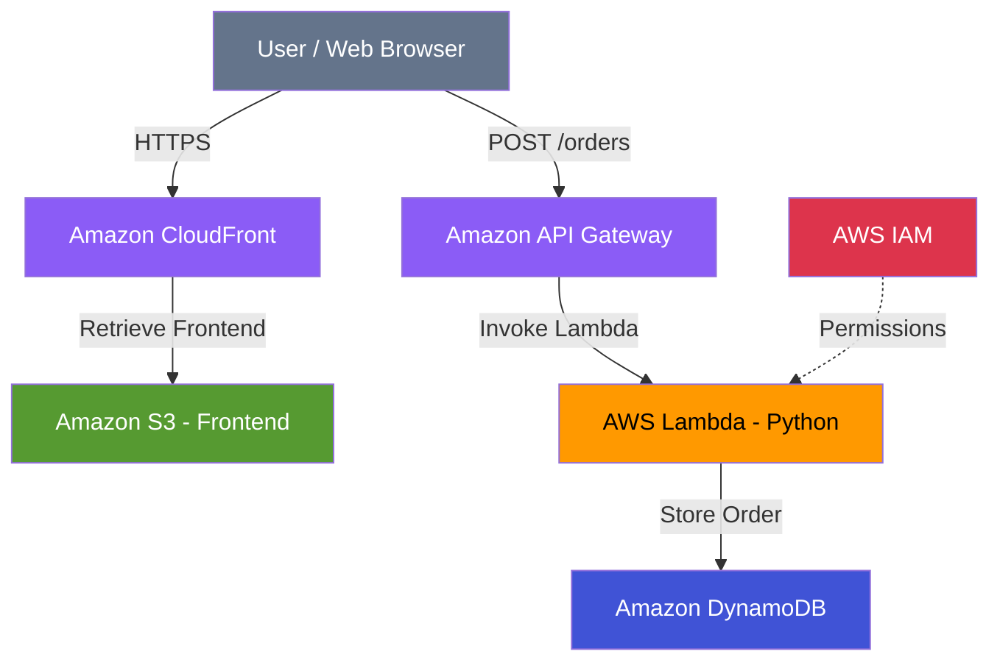
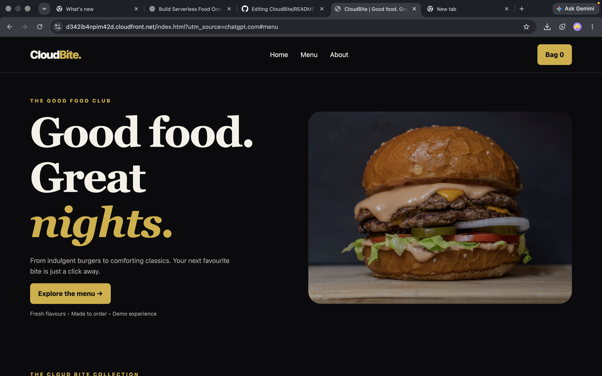
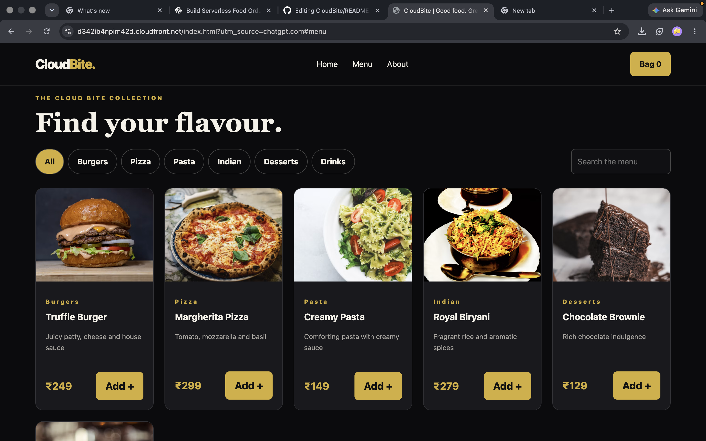
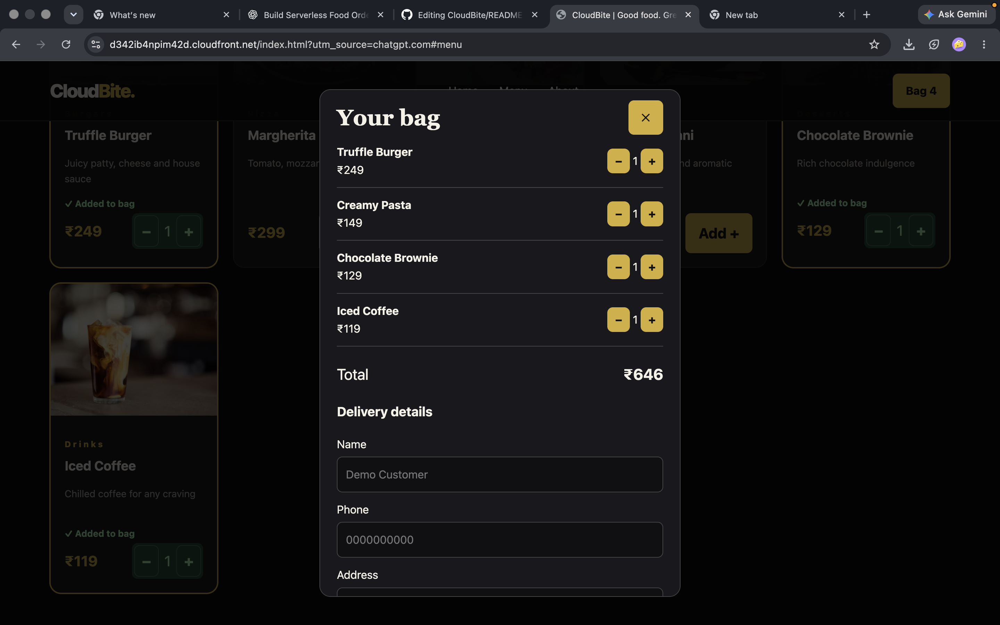
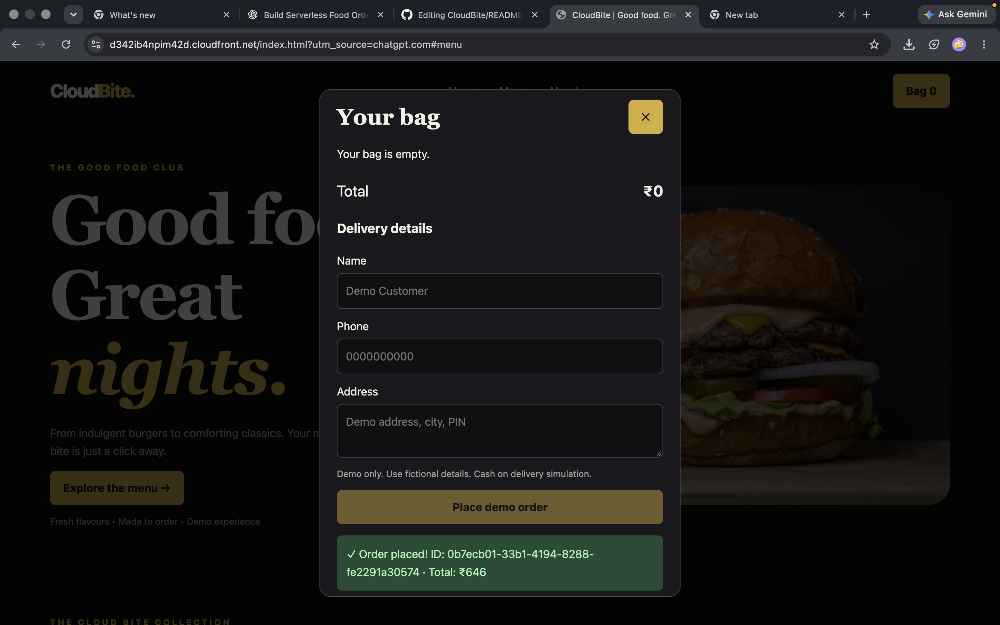

# CloudBite – Serverless Food Ordering System


## Live Website

[Explore CloudBite 2.0](https://d342ib4npim42d.cloudfront.net/)

## Project Overview

CloudBite is a full-stack serverless food ordering application built using Amazon Web Services (AWS).

The application features a premium black and gold interface that allows users to browse food items, filter categories, search the menu, manage a shopping cart, calculate order totals and submit orders to a cloud-based backend.

The project demonstrates serverless computing, HTTP API integration, cloud storage, content delivery and NoSQL database management without maintaining traditional servers.

## Technologies Used

| Technology | Purpose |
|---|---|
| HTML5 | Website structure |
| CSS3 | Responsive website design |
| JavaScript | Frontend logic and API integration |
| Python 3.13 | Backend programming |
| Boto3 | AWS SDK for Python |
| Amazon S3 | Frontend storage |
| Amazon API Gateway | HTTP API request handling |
| AWS Lambda | Serverless order processing |
| Amazon DynamoDB | NoSQL order storage |
| AWS IAM | Access and permission management |
| Amazon CloudFront | HTTPS content delivery and caching |
| GitHub | Source code and version control |
| VS Code | Application development |

## Features

- Premium black and gold website design
- Responsive user interface
- Interactive food menu with photographs
- Food category filtering
- Real-time menu search
- Multi-item shopping cart
- Visual item selection indicators
- Added-to-bag notifications
- Quantity adjustment and item removal
- Automatic bill calculation
- Server-side price calculation
- Customer delivery details collection
- Serverless backend processing
- Unique order ID generation
- Customer input and quantity validation
- Persistent order storage
- Order status and timestamp recording
- Order confirmation messages
- API error handling
- HTTPS content delivery

## System Architecture



## How It Works

1. The user accesses the website through Amazon CloudFront.
2. CloudFront retrieves the frontend files from Amazon S3.
3. The user browses the food menu and adds items to the shopping cart.
4. JavaScript calculates the estimated order total.
5. The user enters delivery details and submits the order.
6. API Gateway receives the POST request.
7. AWS Lambda validates the order details.
8. Lambda calculates the final price using backend menu prices.
9. A unique order ID is generated.
10. The order is stored in Amazon DynamoDB.
11. The website displays a successful order confirmation.

## API Endpoint

- API Type: HTTP API
- Method: POST
- Route: /orders
- Request format: JSON
- Response format: JSON

### Sample Request

```json
{
  "name": "Demo Customer",
  "phone": "9999999999",
  "address": "Demo Address",
  "items": [
    {
      "id": "burger",
      "quantity": 1
    },
    {
      "id": "pasta",
      "quantity": 2
    }
  ]
}
```

### Sample Response

```json
{
  "message": "Order placed successfully!",
  "orderId": "example-unique-order-id",
  "total": 547
}
```

The backend calculates the final order total independently using predefined menu prices.

## AWS Configuration

| Resource | Configuration |
|---|---|
| Region | ap-southeast-2 (Sydney) |
| S3 Bucket | cloudbite-food-ordering-2026 |
| Lambda Function | CloudBitePlaceOrder |
| Lambda Runtime | Python 3.13 |
| DynamoDB Table | CloudBiteOrders |
| Partition Key | orderId |
| API Gateway | CloudBiteAPI |
| CloudFront Distribution | CloudBite |

## Database Design

| Attribute | Data Type |
|---|---|
| orderId | String (Partition Key) |
| name | String |
| phone | String |
| address | String |
| items | List |
| total | Number |
| status | String |
| orderTime | String |

## Project Structure

```text
CloudBite/
├── index.html
├── style.css
├── script.js
├── backend/
│   └── lambda_function.py
├── screenshots/
│   ├── website-interface.png
│   ├── food-menu.png
│   ├── shopping-cart.png
│   └── order-success.png
└── README.md
```

## Website Demonstration

### Homepage



### Food Menu



### Shopping Cart



### Successful Order Placement



## Project Status

| Component | Status |
|---|---|
| Frontend Development | Completed |
| Shopping Cart | Completed |
| Lambda Backend | Completed |
| DynamoDB Integration | Completed |
| API Gateway Integration | Completed |
| Backend Testing | Completed |
| S3 Hosting | Completed |
| CloudFront Deployment | Completed |
| Live End-to-End Testing | Completed |
| Security and Billing Review | Pending |

## Learning Outcomes

- Building serverless applications on AWS
- Designing cloud-based application architecture
- Integrating frontend applications with cloud APIs
- Developing Python-based Lambda functions
- Configuring IAM permissions
- Working with NoSQL databases
- Hosting websites using Amazon S3
- Configuring Amazon CloudFront
- Managing CloudFront cache invalidation
- Troubleshooting cloud applications
- Performing end-to-end application testing
- Managing source code using GitHub
- Writing technical project documentation

## Future Improvements

- Customer authentication using Amazon Cognito
- Customer order history
- Order tracking dashboard
- Restaurant administration dashboard
- Online payment integration
- Enhanced input validation
- API abuse protection
- Application monitoring
- Automated deployment using CI/CD
- Infrastructure as Code using AWS CloudFormation

## Disclaimer

This project is an educational prototype developed for learning cloud computing and serverless application development.

It is not intended for production use, real customer transactions or actual food deliveries. No real payments are processed.

Please use fictional customer details when testing the application.

## Author

**Medhavi Dheer Srivastava**

B.Tech Computer Science and Engineering

Specialization: Cloud Computing

VIT Bhopal University

GitHub: [meds-cloud](https://github.com/meds-cloud)

---

**CloudBite 2.0 — Good Food. Great Nights.**
