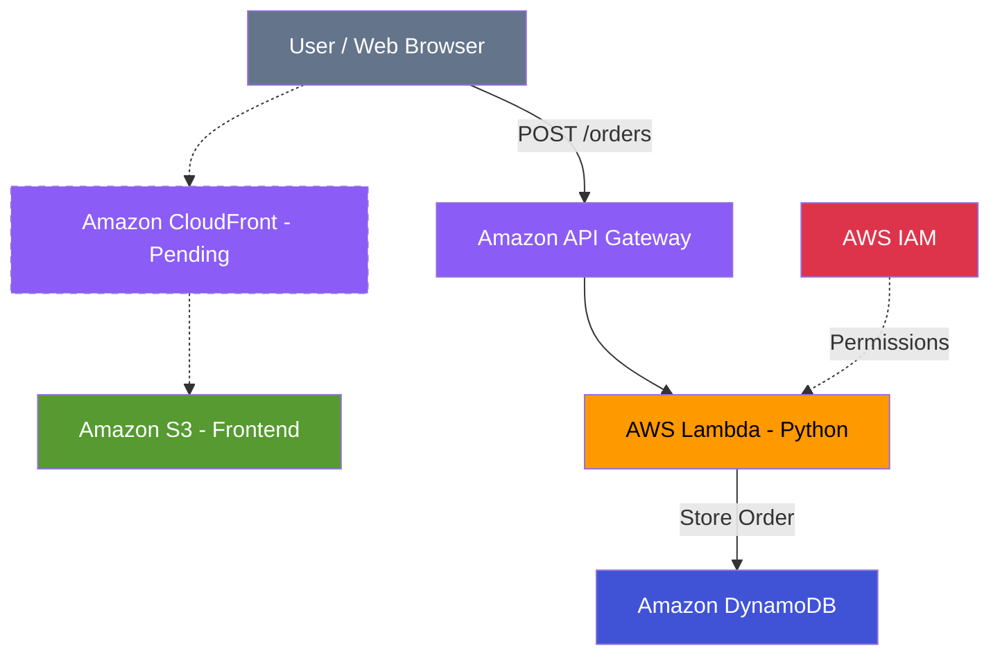

# CloudBite – Serverless Food Ordering System

## Project Overview

CloudBite is a serverless food ordering application built using Amazon Web Services (AWS). It allows users to select food items, calculate their order total, enter delivery details and submit orders to a cloud-based backend.

The project demonstrates serverless computing, REST API integration, cloud storage and NoSQL database management without maintaining traditional servers.

## Technologies Used

| Technology | Purpose |
|---|---|
| HTML | Website structure |
| CSS | Website design |
| JavaScript | Frontend logic and API integration |
| Python 3.13 | Backend programming |
| Amazon S3 | Frontend storage |
| Amazon API Gateway | API request handling |
| AWS Lambda | Serverless order processing |
| Amazon DynamoDB | Order storage |
| AWS IAM | Access and permission management |
| Amazon CloudFront | Planned HTTPS content delivery |
| GitHub | Source code and version control |

## Features

- Interactive food ordering interface
- Automatic bill calculation
- Customer details collection
- Serverless backend processing
- Unique order ID generation
- Order quantity validation
- Persistent order storage
- Order status and timestamp tracking
- API error handling

## System Architecture

## API Endpoint

- Method: POST
- Route: /orders
- Request format: JSON

The backend returns a unique order ID after successfully storing an order.

## AWS Configuration

- Region: ap-southeast-2 (Sydney)
- Lambda function: CloudBitePlaceOrder
- DynamoDB table: CloudBiteOrders
- Partition key: orderId
- API Gateway: CloudBiteAPI

## Project Status

- Frontend development: Completed
- Lambda backend: Completed
- DynamoDB integration: Completed
- API Gateway integration: Completed
- Backend testing: Completed
- S3 configuration: Completed
- CloudFront deployment: Pending AWS account approval

## Learning Outcomes

- Building serverless applications on AWS
- Integrating frontend applications with cloud APIs
- Configuring IAM permissions
- Working with NoSQL databases
- Testing cloud-based APIs
- Managing source code using GitHub

## Future Improvements

- Customer authentication
- Order tracking dashboard
- Online payment integration
- Improved input validation
- API abuse protection
- Automated deployment using CI/CD

## Disclaimer

This project is an educational prototype. It is not intended for production use or real customer transactions. 
## Website Demonstration

The CloudBite interface allows customers to enter delivery details, select food items, calculate the total bill and submit an order to the AWS backend.

### Successful Order Placement

